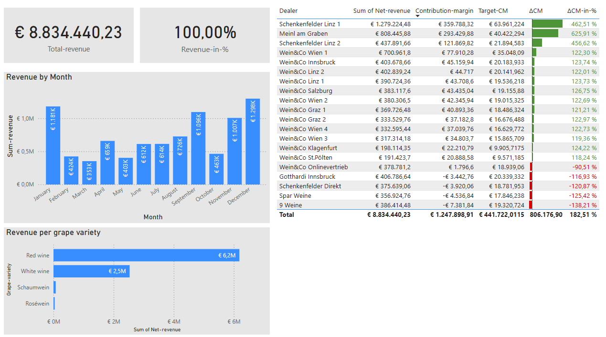
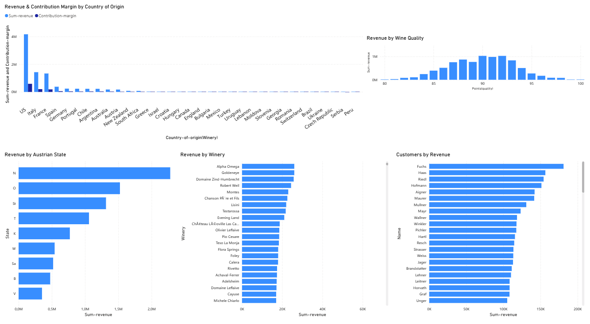
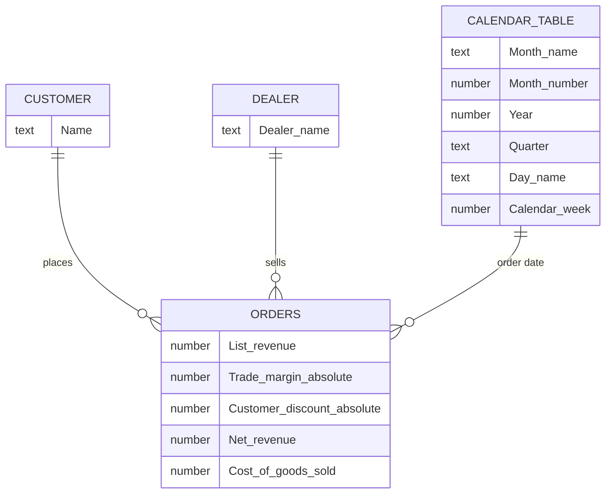

<h1 align="center">🍷 Wine Trade Power BI Dashboard</h1>

<p align="center">
  A Power BI management dashboard, data model and business-intelligence report for a fictional wine trade.
</p>

<p align="center">
  
  
  
  
</p>

> **Note:** This project is my personal coursework, shared for portfolio and reference purposes only. The dataset is fictional. Please do not copy it and submit it as your own work, as that may count as plagiarism under your institution's rules.

<p align="center">
  
</p>

## Table of contents

- [Overview](#overview)
- [Repository contents](#repository-contents)
- [Management dashboard](#management-dashboard)
- [Analysis page: five visualizations](#analysis-page-five-visualizations)
- [Data model](#data-model)
- [Calculated columns and measures](#calculated-columns-and-measures)
- [Key findings and recommendations](#key-findings-and-recommendations)
- [Action plan](#action-plan)
- [How to open the report](#how-to-open-the-report)
- [Tools used](#tools-used)

## Overview

This project analyses the orders of a fictional wine trade. It has three parts:

1. **A management dashboard**, built in Power BI from a template image. It shows total revenue, revenue by month and by grape variety, and a dealer table that compares each dealer's contribution margin with its target.
2. **An analysis page** with five visualizations on sourcing, customer geography, wine quality, top customers and top wineries.
3. **A PDF report** that turns those five visualizations into recommendations for management.

**Total net revenue in the period: € 8,834,440.23.**

## Repository contents

```text
wine-trade-powerbi-dashboard/
├── Class2FN.pbix                      Power BI report (data model, measures, both report pages)
├── ReportFN Wine.pdf                  7-page business-intelligence report with recommendations
├── Screenshots/                       Images of the dashboard and each visualization
│   ├── Main.png
│   ├── Dashboard.png
│   └── ...
├── New folder/                        The four source Excel files
│   ├── E2_BPI_Dashboard_Wine_trade_Orders.xlsx
│   ├── E2_BPI_Dashboard_Wine_trade_Customers.xlsx
│   ├── E2_BPI_Dashboard_Wine_trade_Dealers.xlsx
│   └── E2_BPI_Dashboard_Wine_trade_Date_table.xlsx
└── README.md
```

| File | What it is |
|---|---|
| `Class2FN.pbix` | The Power BI report. It contains the loaded data, the relationships, the Power Query steps, the DAX measures and both report pages. |
| `ReportFN Wine.pdf` | The written report: executive summary, one section per visualization (finding and three recommendations each), and an action plan. |
| `Screenshots/` | Screenshots used in this README and in the PDF report. |
| `New folder/` | The source data: one transaction table (orders) and three dimension tables (customers, dealers, dates). |

## Management dashboard

The first report page recreates a management dashboard and answers two questions: *how much did we sell, and which dealers meet their contribution-margin target?*

<p align="center">
  
</p>

| Element | What it shows |
|---|---|
| **Cards** | Total revenue (€ 8,834,440.23) and revenue in % (100.00% when nothing is filtered). |
| **Revenue by Month** | Column chart of net revenue per month. Revenue peaks in December (€ 1.298M) and January (€ 1.181M), and is lowest in March (€ 353K). |
| **Revenue per grape variety** | Bar chart: red wine € 6.2M, white wine € 2.5M, and much smaller sales of Schaumwein and Rosé. |
| **Dealer table** | Net revenue, contribution margin, target contribution margin (Target-CM), ΔCM and ΔCM-in-% per dealer, with green data bars for dealers above target and red for dealers below. |

Dealers below target (negative ΔCM) in the table: Wein&Co Onlinevertrieb, Gotthardi Innsbruck, Schenkenfelder Direkt, Spar Weine and 9 Weine.

**Interactions:** clicking a dealer in the table *filters* the month and grape-variety charts instead of only highlighting a share of each bar (set with *Edit interactions*).

## Analysis page: five visualizations

The second report page contains five visualizations that the PDF report is based on.

<p align="center">
  
</p>

| # | Visualization | Question it answers |
|---|---|---|
| 1 | Revenue and contribution margin by country of origin | Which sourcing countries drive revenue and margin? |
| 2 | Revenue by Austrian state | Where in Austria are customers buying? |
| 3 | Revenue by wine quality (points) | Which quality segment sells best? |
| 4 | Customers by revenue | How concentrated is the customer base? |
| 5 | Revenue by winery | How dependent is the business on a few suppliers? |

### 1. Revenue and contribution margin by country of origin

<p align="center">
  
</p>

The United States generates about € 4.16M, which is 47% of total revenue. Italy (€ 1.43M) and France (€ 1.33M) follow. Contribution margins are small compared with revenue for most countries.

### 2. Revenue by Austrian state

<p align="center">
  
</p>

Lower Austria (N) is strongest at € 2.28M (26%), ahead of Upper Austria (O, € 1.52M) and Styria (St, € 1.31M). Vienna (W) ranks only 6th at € 542K, and Vorarlberg (V) is last at € 352K (4%).

### 3. Revenue by wine quality

<p align="center">
  
</p>

Revenue follows a bell curve that peaks at 90 to 92 points. The best-selling range is 88 to 93 points, while wines below 85 points sell little.

### 4. Customers by revenue

<p align="center">
  
</p>

The top customer (Fuchs) brings in € 181,007, and the top five customers (Fuchs, Haas, Riedl, Hofmann, Aigner) together contribute over € 784,000. The distribution among the top customers is fairly flat.

### 5. Revenue by winery

<p align="center">
  
</p>

Errazuriz leads with € 61,920, followed by Louis Latour with € 51,679. A second tier (Château Haut-Brion, Dr. Hermann, Gary Farrell) sits around € 33,000 to € 36,000.

## Data model

One transaction table (Orders) is linked to three dimension tables. Each relationship is one-to-many: a value appears once in the dimension table and many times in Orders.



Preparation steps in Power Query:

- Fixed the date format in the customer table.
- Removed the *Order month* column from Orders.
- Renamed *Branch/Online* to *Dealer-name* in the dealer table.
- Renamed the date table to *Calendar table* and added the calendar columns shown above.

## Calculated columns and measures

**Calculated columns in Orders (Power Query):**

| Column | Formula |
|---|---|
| List-revenue | List-price (excl. VAT) × Order-quantity |
| Trade-margin-absolute | List-revenue × Trade-margin-% |
| Customer-discount-absolute | List-revenue × Customer-discount-% |
| Net-revenue | List-revenue − Customer-discount-absolute |
| Cost-of-goods-sold | List-revenue − Trade-margin-absolute |

**DAX measures:**

| Measure | Definition |
|---|---|
| Sum-revenue | Sum of Net-revenue |
| Gross-profit | Sum-revenue − Cost-of-goods-sold |
| Contribution-margin | Gross-profit − Shipping-costs |
| Target-CM | Sum-revenue × 0.05 |
| Total-revenue | Total revenue without filter context (does not change with filters) |
| Revenue-in-% | Total-revenue divided by overall total revenue |
| ΔCM | Contribution-margin − Target-CM |
| ΔCM-in-% | Contribution-margin ÷ Target-CM − 1 |

## Key findings and recommendations

The full text, with three recommendations per visualization, is in [`ReportFN Wine.pdf`](ReportFN%20Wine.pdf).

| Area | Key finding | Priority |
|---|---|---|
| Country of origin | The US accounts for 47% of revenue, so the business depends heavily on one source. | High |
| Austrian states | Lower Austria produces 26% of revenue, Vorarlberg only 4%, and Vienna underperforms. | High |
| Wine quality | Revenue peaks at 90 to 92 points: the mid-premium sweet spot. | Medium |
| Top customers | A few customers drive a large share of revenue, which is a concentration risk. | High |
| Top wineries | Errazuriz and Louis Latour lead by a wide margin, which creates supplier dependency. | Medium |

## Action plan

| Priority | Action | Timeline |
|---|---|---|
| 1 | Launch a VIP loyalty program for the top 10 customers | Q1 |
| 2 | Investigate and address the low revenue in Vienna | Q1 |
| 3 | Negotiate a preferred supplier deal with Errazuriz and Louis Latour | Q1 |
| 4 | Reduce US wine dependency by growing Italian and French sourcing | Q2 |
| 5 | Run a targeted marketing campaign in Vorarlberg, Burgenland and Salzburg | Q2 |
| 6 | Focus the assortment on wines of 88 to 93 points | Q2 |
| 7 | Phase out wines below 85 points | Q3 |
| 8 | Develop new winery partnerships in Italy and France | Q3 |

## How to open the report

1. Install **Power BI Desktop** (Windows only; it has no native Mac version).
2. Download `Class2FN.pbix` and open it. Both report pages display with the data saved in the file.
3. To **refresh** the data, point the report at your own copy of the Excel files. Go to **Home → Transform data → Data source settings → Change Source**. Select each of the four sources, browse to the `New folder` directory and choose the matching file. Then click **Close & Apply**.

You can also upload the `.pbix` to [app.powerbi.com](https://app.powerbi.com) to view the report in a browser.

## Tools used

- **Power BI Desktop**: report, visuals and data model
- **Power Query**: data cleaning and calculated columns
- **DAX**: measures
- **Excel**: source data

## Notes

The dataset is fictional and was provided for an exercise.
